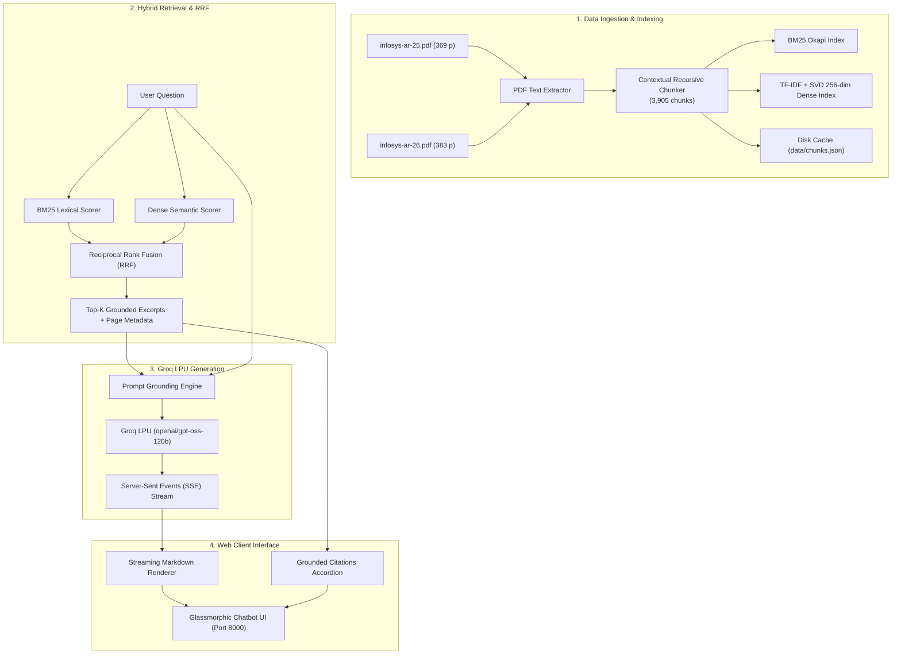

# 🏢 Infosys Enterprise RAG AI Assistant

[](https://www.python.org/)
[](https://fastapi.tiangolo.com/)
[](https://groq.com/)
[](LICENSE)

An enterprise-grade Retrieval-Augmented Generation (RAG) conversational platform designed to answer complex questions about **Infosys Limited**. Grounded in official **Integrated Annual Reports (FY 2024–25 and FY 2025–26)**, powered by ultra-low-latency **Groq LPU** inference and a glassmorphic web interface.

---

## 🌟 Key Features

- **Official Grounding Corpus**:
  - `infosys-ar-25.pdf` (*Integrated Annual Report 2024–25*, 369 pages — *"AI Your Enterprise"*)
  - `infosys-ar-26.pdf` (*Integrated Annual Report 2025–26*, 383 pages — *"AI-First Enterprise & $20B Milestone"*)
  - **752 total pages** indexed into **3,905 semantic chunks**.
- **State-of-the-Art Hybrid RAG Pipeline**:
  - **Lexical BM25 Indexing**: Exact matching for financial statistics, executive statements, deal values (TCV), and proprietary platforms (*Infosys Topaz*, *Infosys Cobalt*, *Finacle*, *EdgeVerve*).
  - **Dense Semantic Indexing**: TF-IDF + Latent Semantic Analysis (256-dimensional SVD vector embeddings) for conceptual and strategic queries.
  - **Reciprocal Rank Fusion (RRF)**: Merges sparse and dense search scores ($k=60$) to deliver high precision.
  - **Sub-150ms Cold Starts**: Pre-indexed chunks in `data/chunks.json` for rapid loading.
- **Groq LPU Ultra-Low Latency Inference**:
  - Models supported: `openai/gpt-oss-120b` (deep reasoning & analysis), `qwen/qwen3.8-27b` (ultra-fast factual QA), and `openai/gpt-oss-20b`.
  - Real-time Server-Sent Events (SSE) streaming (`/api/chat/stream`) for token-by-token generation.
- **Glassmorphic Web Interface**:
  - Dark-mode obsidian theme with ambient lighting and responsive design.
  - **Grounded Citations Accordion**: Inspect exact page numbers, report titles, and relevance match percentages.
  - **Interactive Knowledge Base Explorer**: Search and preview raw chunk snippets and similarity scores.
  - **Speech Recognition & Audio Playback**: Voice input and text-to-speech built-in.
  - **Chat Export**: Download conversation history in GitHub-flavored Markdown.

---

## 🏗️ Architecture



---

## 🚀 Quick Start Guide

### 1. Clone the Repository
```bash
git clone https://github.com/YOUR_USERNAME/RAG_infosis_chatbot.git
cd RAG_infosis_chatbot
```

### 2. Set Up Virtual Environment & Dependencies
```bash
# Create virtual environment
python3 -m venv .venv
source .venv/bin/activate

# Install dependencies
pip install -r requirements.txt
```

### 3. Configure Groq API Key
Copy the example environment file and add your Groq API key:
```bash
cp .env.example .env
```
Edit `.env` and set:
```ini
GROQ_API_KEY=gsk_your_actual_key_here
```
*(Get your free API key at [Groq Console](https://console.groq.com/keys))*

### 4. Run the Application

#### Option A: Web Chatbot Interface (Recommended)
```bash
# Using the launcher script
./start.sh

# Or directly with python
python server.py
```
Open **[http://localhost:8000](http://localhost:8000)** in your browser.

#### Option B: Terminal Interactive Assistant
```bash
python rag_engine.py
```

---

## 📂 Project Structure

```text
├── config.py                 # Configuration, models, and PDF document metadata
├── rag_engine.py             # RAG engine: PDF parsing, BM25, SVD indexing, RRF ranking
├── server.py                 # FastAPI backend with SSE streaming & search endpoints
├── start.sh                  # One-click startup script
├── requirements.txt          # Python dependencies
├── .env.example              # Environment variables template
├── .gitignore                # Git ignore configuration
├── infosys-ar-25.pdf         # Infosys Integrated Annual Report 2024-25 (369 pages)
├── infosys-ar-26.pdf         # Infosys Integrated Annual Report 2025-26 (383 pages)
├── data/
│   └── chunks.json           # Cached 3,905 parsed chunks
└── static/
    ├── index.html            # Glassmorphic web chatbot UI
    ├── style.css             # Custom CSS design system
    └── app.js                # Frontend streaming controller & markdown renderer
```

---

## ⚙️ API Endpoints

| Method | Endpoint | Description |
| :--- | :--- | :--- |
| `GET` | `/` | Serves the web chatbot interface |
| `GET` | `/api/status` | Returns system status, model list, and indexing stats |
| `POST` | `/api/chat/stream` | Real-time SSE streaming answer with citations |
| `POST` | `/api/chat` | Non-streaming JSON answer endpoint |
| `POST` | `/api/search` | Direct hybrid/semantic search against document chunks |
| `POST` | `/api/key` | Validates and updates Groq API key dynamically |

---

## 📄 License

This project is licensed under the MIT License - see the [LICENSE](LICENSE) file for details.
